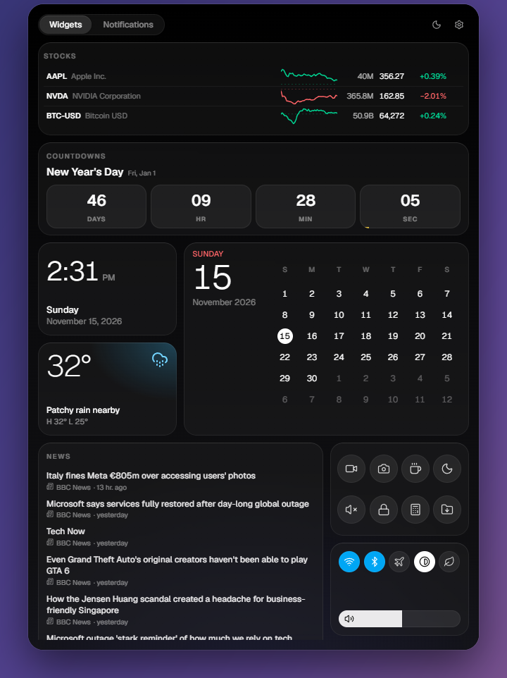
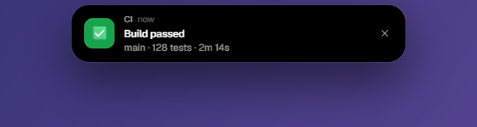
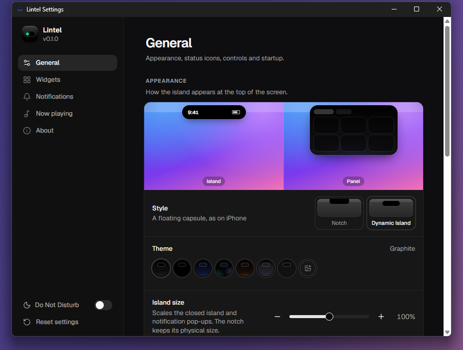
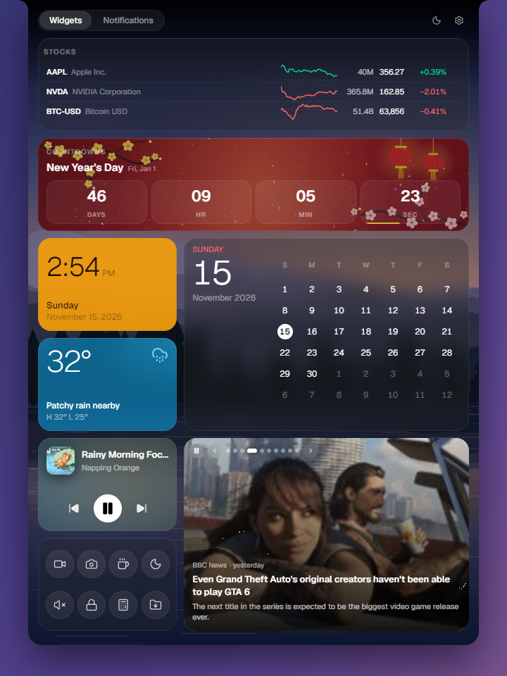
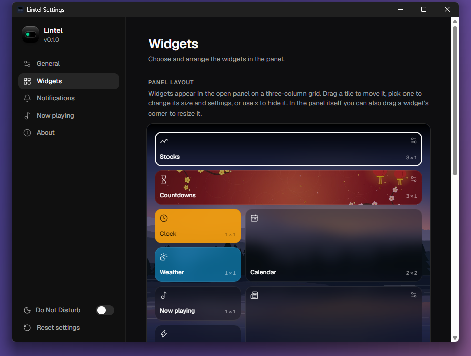
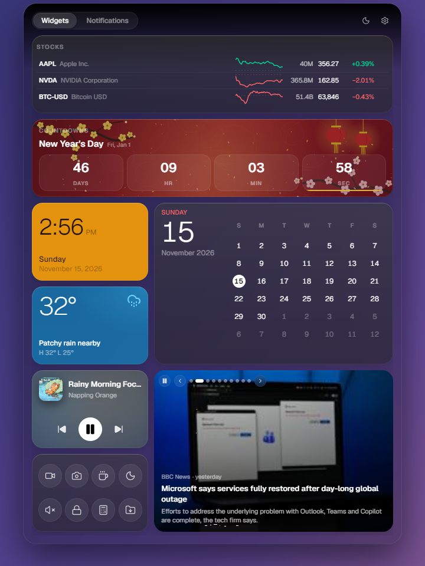
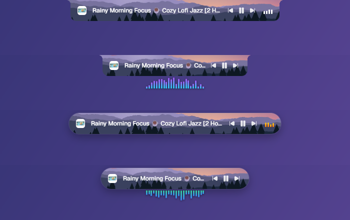

<div align="center">


# Lintel

### Your desktop, one glance away.

A small island at the top of your screen for notifications, music, widgets and quick controls.<br>
Free and open source, for Windows and macOS.

[](#platform-support)
[](https://v2.tauri.app)
[](https://github.com/TanPhan263/Lintel/actions/workflows/ci.yml)
[](LICENSE)

**[Install](#installation)** · **[Screenshots](#screenshots)** · **[Features](#features)** · **[Local API](#local-api)** · **[Build from source](#building-from-source)**


<sub>One small island. Everything at a glance.</sub>

</div>

## Contents

- [Why Lintel?](#why-lintel)
- [Screenshots](#screenshots)
- [Features](#features)
- [Platform support](#platform-support)
- [Installation](#installation)
- [Getting started](#getting-started)
- [Browser extension](#browser-extension)
- [Local API](#local-api)
- [Roadmap](#roadmap)
- [FAQ](#faq)
- [Building from source](#building-from-source)
- [Project structure](#project-structure)
- [Contributing](#contributing)
- [License](#license)

## Why Lintel?

- **Everything in one place.** Notifications, the song that's playing, a timer, stocks, news, your calendar and system controls live in one island at the top center of the screen. Hover over it instead of digging through the tray, the Action Center and several apps.
- **Stays out of the way.** Clicks pass through everywhere outside the island, and it steps aside when a full-screen app, game, video or presentation is in front. With the island closed it uses about 0.5% of one CPU core.
- **Make it yours.** Two styles, eight themes or your own pictures, and a color, text color, opacity or picture for each widget card. Lintel speaks eight languages.
- **Works with your tools.** Scripts and CI jobs can send notifications over a local HTTP API, and a browser extension brings website notifications and music in, pairing itself.

## Screenshots

<table>
  <tr>
    <td align="center" width="45%" rowspan="3">
      <br>
      <sub><b>Widget panel</b>: stocks, a countdown to New Year's Day, and headlines from BBC's technology RSS feed</sub>
    </td>
    <td align="center" width="55%">
      <br>
      <sub><b>Status icons</b> on the closed island</sub>
    </td>
  </tr>
  <tr>
    <td align="center">
      <br>
      <sub><b>Notification</b> from the local API</sub>
    </td>
  </tr>
  <tr>
    <td align="center">
      <br>
      <sub><b>Settings</b></sub>
    </td>
  </tr>
</table>

### Make it yours

The Picture theme puts your own photos behind the panel and the island, and each widget card can have its own color, text color, opacity or picture. Below: the Notch style with a mountain lake for the panel and a strip of the same ridge for the island, an amber Clock card, a sky-blue Weather card, a red spring picture (apricot and peach blossoms, lanterns) behind the New Year's Day countdown, and News as slides.

<table>
  <tr>
    <td align="center" width="45%" rowspan="3">
      <br>
      <sub><b>Picture theme</b> with custom cards and News as slides</sub>
    </td>
    <td align="center" width="55%">
      <br>
      <sub><b>Notch style</b> with an island picture</sub>
    </td>
  </tr>
  <tr>
    <td align="center">
      <br>
      <sub><b>A stock pinned</b> to the closed island</sub>
    </td>
  </tr>
  <tr>
    <td align="center">
      <br>
      <sub><b>Panel layout editor</b>: drag tiles, set sizes, colors and pictures</sub>
    </td>
  </tr>
</table>

The **Transparent** theme lets the desktop show through, with frosted cards on the panel and a clear pill for the closed island:

<table>
  <tr>
    <td align="center" width="45%">
      <br>
      <sub><b>Transparent</b> panel</sub>
    </td>
    <td align="center" width="55%">
      <br>
      <sub><b>Transparent</b> island, Dynamic Island style, playing music</sub>
    </td>
  </tr>
</table>

### Music

<table>
  <tr>
    <td align="center" width="45%">
      <br>
      <sub><b>Music bars</b> follow the sound, here below the island</sub>
    </td>
    <td align="center" width="55%">
      <br>
      <sub><b>Layouts</b>: inside or below, upright or flipped, any two-color gradient, on either style</sub>
    </td>
  </tr>
</table>

## Features

| Feature | What it does |
|---|---|
| **Notifications** | Pop out of the island for a few seconds, then wait in the Notifications tab. Do Not Disturb keeps them quiet. |
| **Live activities** | A running timer, unread count, music bars, and green and orange dots while an app uses the camera or microphone. |
| **Now playing** | Cover art, title and playback controls for the song that's playing. See [Platform support](#platform-support) for which players. |
| **Controls** | Wi-Fi, Bluetooth, airplane mode, dark mode, night light or Night Shift, energy saver, volume and brightness. |
| **Status icons** | Round gauges beside the closed island for the time, date, CPU, memory, disk, battery, weather and unread mail. Drag them into place in Settings. |
| **Widgets** | Clock, Calendar, Timer, System (CPU, memory, battery), Notes, Weather, Stocks, Now playing, News, Upcoming events, Countdowns, Controls and Quick actions. Drag to move, drag a corner to resize, and give each card its own color, text color, opacity or picture. |
| **News and events** | Headlines from any RSS or Atom feed (or a news site that names one), as a list or as slides, and the next 30 days from private calendar links (`.ics` or `webcal://`). |
| **Countdowns** | Days, hours, minutes and seconds to the dates you name, like a trip or New Year's Day. |
| **Quick actions** | Record screen, screenshot, keep awake, Do Not Disturb, mute, lock, calculator, downloads. |
| **Stocks** | Live prices from Yahoo Finance, with Vietnamese stocks (HOSE, HNX, UPCoM) from VPS. Pin up to 3 symbols to the island. |
| **Website notifications** | A browser extension forwards notifications from Gmail, Slack, Discord and other sites. |
| **Local API** | Scripts, CI jobs and tools can send notifications over HTTP. |
| **Themes** | Graphite, Black, Midnight, Aurora, Ember, Slate, Transparent, or your own pictures, framed with a built-in cropper. |
| **Two styles** | *Notch*, hanging from the top edge, or a floating capsule just below it. Both can be resized. |
| **8 languages** | English, 简体中文, Tiếng Việt, 日本語, 한국어, Español, Français and Deutsch. Lintel follows your system language. |

## Platform support

Most of Lintel works the same on both systems. Where Windows and macOS differ, this table says how.

| Feature | Windows 10 / 11 | macOS 12+ |
|---|---|---|
| Island, widget panel, themes, status icons | ✓ | ✓ |
| Notch style | Hangs from the top edge | Wraps around the MacBook notch |
| Notifications from scripts and websites | ✓ | ✓ |
| Camera and microphone dots | ✓ | ✓ |
| Now playing: desktop players | Any app in the volume flyout (Spotify, Media Player, browsers…) | Spotify and Apple Music |
| Now playing: websites (with the extension) | ✓ | ✓ |
| Play, pause and skip | Every app | Spotify and Apple Music |
| Wi-Fi, Bluetooth, volume, dark mode | ✓ | ✓ |
| Brightness | Built-in screen | Built-in screen |
| Airplane mode | ✓ (switches every radio) | — (macOS has none) |
| Night light / Night Shift | — (no public switch) | ✓ |
| Energy saver | Opens Battery saver settings | Opens Low Power Mode settings |
| Record screen | Opens Snipping Tool | Records the main display to the Desktop |
| Unread mail icon | — | Mail or Outlook Dock badge |
| Start at login | ✓ | ✓ |
| Notifications from other desktop apps | — | — |

The last row is the same on both: neither system gives an ordinary app a public way to read other apps' notifications. See the [FAQ](#faq).

## Installation

> [!NOTE]
> **Prebuilt installers are coming soon.** For now, you can [build Lintel from source](#building-from-source); it takes a few minutes. [Watch the repository](https://github.com/TanPhan263/Lintel) (Watch → Custom → Releases) to hear when the first release is out.

**Requirements:** Windows 10 or 11 (64-bit) with the Microsoft WebView2 runtime (built into Windows 11), or macOS 12 Monterey or later.

Once installers are published on the [Releases page](https://github.com/TanPhan263/Lintel/releases):

- **Windows:** run `Lintel_x.y.z_x64-setup.exe` or the `.msi`. Until the installers are code-signed, SmartScreen may say the app is unrecognized; choose **More info → Run anyway**. Lintel starts in the system tray.
- **macOS:** open `Lintel_x.y.z_*.dmg` and drag **Lintel** to **Applications**. Until the app is notarized, right-click it and choose **Open** the first time. Lintel runs from the menu bar.

The Settings window opens on first launch with a short welcome.

## Getting started

| Action | How |
|---|---|
| Open the island | Hover over it (or click it, if you prefer, in Settings) |
| Toggle from anywhere | `Ctrl+Shift+Space` (Windows) / `Cmd+Shift+Space` (macOS) |
| Close | `Esc`, or move the pointer away |
| Arrange widgets | Drag a card to move it, drag its bottom-right corner to resize |
| Follow the news | **Settings → Widgets → News**: paste a site or its RSS feed, for example `https://feeds.bbci.co.uk/news/technology/rss.xml` |
| Count down to a day | **Settings → Widgets → Countdowns**: a name and a date, for example *New Year's Day*, 2027-01-01 |
| Settings | Tray or menu bar icon → **Settings** |
| Start at login | On by default; **Settings → General → System** turns it off |
| Quit | Tray or menu bar icon → **Quit Lintel** (closing Settings only hides it) |

## Browser extension

The extension in [`extension/`](extension/) forwards website notifications and now-playing info to Lintel. It works in Chrome, Edge, Brave, Arc and other Chromium browsers (version 111 or later).

1. Open `chrome://extensions` and turn on **Developer mode**.
2. Click **Load unpacked** and choose the `extension` folder. **Settings → Notifications → Show folder** opens it.

That's all: the extension pairs with Lintel by itself. Each time Lintel starts, it registers itself with Chrome (including Beta, Dev and Canary), Edge, Brave, Chromium, Arc and Vivaldi as the extension's [native messaging host](https://developer.chrome.com/docs/extensions/develop/concepts/native-messaging) (for your user only, no admin rights). The extension asks it for the pairing token when it's installed, when the browser starts, and whenever Lintel turns its token down. Only the Lintel extension, by its fixed ID, may ask. If the popup says it can't reach Lintel, start Lintel once, then reload the extension.

Good to know:

- A site sends notifications only after you allow them in the browser, and only while it's open in a tab.
- To avoid seeing each notification twice, turn off the browser's own notifications in your system's notification settings. Lintel keeps receiving them.
- Each site can send at most 12 notifications a minute, and repeats within 3 seconds are dropped.

## Local API

Anything on your computer can send a notification:

```sh
curl -X POST http://127.0.0.1:47821/v1/notify \
  -H 'Content-Type: application/json' \
  -d '{"title":"Build passed","body":"main · 2m 14s","app":"CI","icon":"✅","accent":"#16a34a"}'
```

| Field | Description |
|---|---|
| `title` | Required, up to 120 characters |
| `body` | Optional, up to 500 characters |
| `app` | Sender name shown above the title (default `Script`) |
| `icon` | An emoji or up to 4 characters |
| `accent` | Icon background, as a hex color |
| `image` | A small picture instead of the icon: a base64 PNG, JPEG, WebP or GIF data URL, up to 12 KiB |

`GET /v1/health` checks that Lintel is running.

**Security:** the server listens on `127.0.0.1` only and accepts only JSON. It refuses requests from web pages and requests whose `Host` isn't the loopback address. Browser extensions must send the pairing token (`Authorization: Bearer <token>`). You can change the port or turn the API off in **Settings → Notifications → Website notifications**.

## Roadmap

Planned, roughly in this order:

- [ ] **First release** with Windows (`.exe`, `.msi`) and macOS (`.dmg`) installers. CI already builds them on every push.
- [ ] **Signed installers**, so Windows SmartScreen and macOS Gatekeeper stop warning.
- [ ] **Notifications from Windows desktop apps** such as Zalo, Teams or Outlook, after you allow notification access. Windows only lets packaged apps read them, so this needs a small change to how Lintel is installed.
- [ ] **Clearer text on bright island pictures**: prices and titles can be hard to read over a light photo.

Ideas and votes are welcome in [Issues](https://github.com/TanPhan263/Lintel/issues).

## FAQ

<details>
<summary><b>The island disappeared. Where did it go?</b></summary>

It steps aside while a full-screen app, game, video or presentation is in front, and comes back when you leave full screen. `Ctrl+Shift+Space` (`Cmd+Shift+Space` on macOS) shows it anyway. The tray or menu bar menu can also hide it; choose the same item again to bring it back.
</details>

<details>
<summary><b>Can it show notifications from desktop apps like Slack, Zalo or Steam?</b></summary>

Not yet. Those apps send system notifications, and macOS has no public API for reading them. Windows has one, but only for packaged apps; it's on the [roadmap](#roadmap). For now, use the web version of the app (Slack, Discord, Gmail, Zalo Web…) with the [browser extension](#browser-extension).
</details>

<details>
<summary><b>How much CPU and memory does it use?</b></summary>

Measured on a Windows release build: with the island closed, about 0.5% of one CPU core. With the panel open and live stock prices animating, about 13% of one core; without the Stocks card, about 4%. It uses about 200 MB of memory, of which Lintel's own process is about 15 MB; the rest is the WebView2 (Edge) runtime that draws the interface. Animations run at the display's full frame rate.
</details>

<details>
<summary><b>Which permissions does it need?</b></summary>

None on Windows. On macOS, the system asks only when you use a feature that needs it: Screen Recording to record the screen, and permission to control Spotify or Music for their play, pause and skip buttons. The unread mail count comes from the Dock badge, and the camera and microphone dots from the system's usage state, without a prompt.
</details>

<details>
<summary><b>Does Lintel send my data anywhere?</b></summary>

There are no accounts, analytics or telemetry. Lintel only connects to the services behind the widgets you use: [wttr.in](https://wttr.in) for the weather (it finds your city from your IP address), Yahoo Finance, VPS and VNDirect for stock prices, Spotify for album covers, and the news feeds and calendar links you add. The local API listens on your own computer only.
</details>

<details>
<summary><b>Why does Windows warn when I run the installer?</b></summary>

The installers aren't code-signed yet, so SmartScreen doesn't recognize them. Choose **More info → Run anyway**, or build Lintel from source. Signing is on the [roadmap](#roadmap).
</details>

## Building from source

**Requirements:** Node.js 20+, Rust 1.85+, and the [Tauri 2 prerequisites](https://v2.tauri.app/start/prerequisites/) for your OS.

```sh
git clone https://github.com/TanPhan263/Lintel.git
cd Lintel
npm install

npm run tauri dev              # run with hot reload
npm test                       # frontend and extension tests (Vitest)
cd src-tauri && cargo test     # Rust tests
npm run tauri build            # installers: .msi / .exe on Windows, .app / .dmg on macOS
npm run icons                  # regenerate app and tray icons
```

Built installers are written to `src-tauri/target/release/bundle/`.

## Project structure

```text
src/
  island/            The island window: state machine, geometry, views and widgets
  settings/          The Settings window
  shared/            Types, IPC wrappers, events, formatting and translations
  components/ui/     shadcn-style UI components
src-tauri/src/
  core/              Island window, notifications, local API, system monitor, settings
  platform/          macOS (AppKit) and Windows (Win32) integration
  controls/          System controls: Wi-Fi, Bluetooth, volume, brightness and more
  tray.rs            Tray / menu bar menu
extension/           Chromium browser extension
```

The interface uses React, Tailwind CSS v4, Radix primitives, Lucide icons and Motion. The native core is Rust on [Tauri 2](https://v2.tauri.app).

## Contributing

Bug reports, ideas and pull requests are welcome.

- **Found a bug or have an idea?** [Open an issue](https://github.com/TanPhan263/Lintel/issues). For bugs, say which system you're on and how to make it happen.
- **Sending code?** Fork the repository, make a branch, and keep each pull request to one change. Before you open it, run `npm run build`, `npm test` and `cargo test` (in `src-tauri`); [CI](https://github.com/TanPhan263/Lintel/actions/workflows/ci.yml) runs the same checks on Windows and macOS.
- **Adding text to the interface?** Add each new string to every language file in [`src/shared/i18n/`](src/shared/i18n/).

## License

[MIT](LICENSE) © 2026 Phan Nhật Tân
